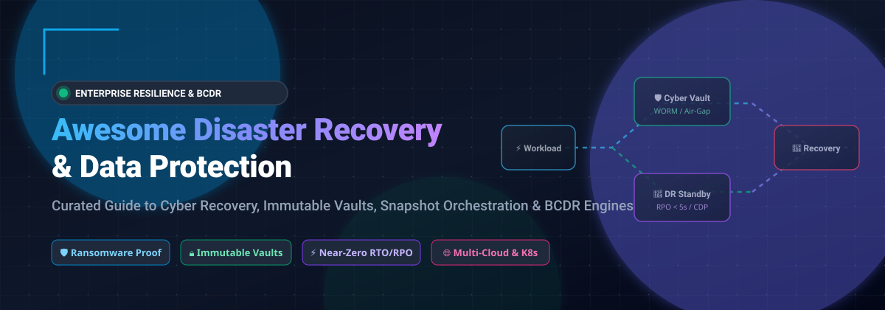

  

# 🛡️ Awesome Disaster Recovery & Data Protection

  
  
  
  
  
  

> **A comprehensive, SEO-optimized directory of enterprise SaaS solutions, continuous data protection (CDP) platforms, and production-ready open-source engines for cyber vault recovery, snapshot orchestration, ransomware mitigation, and business continuity (BCDR).**

---

## 📑 Table of Contents

- [🌐 Sector Overview & Market Dynamics](#-sector-overview--market-dynamics)
- [☁️ Enterprise SaaS & Commercial Solutions](#️-enterprise-saas--commercial-solutions)
- [💻 Open-Source Backup & DR Engines](#-open-source-backup--dr-engines)
- [🏗️ Architectural Frameworks & Patterns](#️-architectural-frameworks--patterns)
- [🤝 How to Contribute](#-how-to-contribute)
- [☕ Support & Sponsorship](#-support--sponsorship)
- [📈 Star History](#-star-history)
- [⚖️ Disclaimer](#️-disclaimer)

---

## 🌐 Sector Overview & Market Dynamics

The global **Disaster Recovery as a Service (DRaaS) and Data Protection market** was valued at approximately **$14.5 billion in 2024** and is projected to expand to over **$42.8 billion by 2030**, advancing at a compound annual growth rate (CAGR) of ~19.8%.

The sector is **moderately fragmented with strong consolidation trends** at the high-end enterprise layer. While hyperscalers and dedicated cyber-resilience giants (such as Veeam, Rubrik, Cohesity, and Commvault) hold dominant market share in regulated enterprise banking, healthcare, and multi-cloud infrastructure, high fragmentation persists in mid-market infrastructure, container-native stateful backup, and edge/self-hosted workloads. The threat of sophisticated ransomware has shifted buyer priority from mere backup copies to zero-trust cyber vaults, air-gapped immutable storage, and instant disaster orchestration.

---

## ☁️ Enterprise SaaS & Commercial Solutions

The following table benchmarks category-leading commercial data resilience platforms, sorted in descending order by **Company Size / Valuation / Revenue**.

| Product | Company Size / Valuation / Revenue | Specific Starting Pricing | Free Tier / Trial Limit | Workload Focus & Key Features |
| :--- | :--- | :--- | :--- | :--- |
| **AWS Backup** | **$2.5T+ (Amazon Market Cap)** / AWS ~$105B+ Ann. Revenue Run Rate | **$0.05/GB-month** (Warm EBS backup storage), **$0.01/GB-month** (Cold archive storage) | **AWS Free Tier (Permanent)**: 5 GB EBS snapshot storage free for 12 months; continuous free tier for AWS Organizations console management | Policy-based centralized backup orchestration across 20+ AWS services, S3 Vault lock, and cross-region automated replication. |
| **Snowflake Fail-safe** | **~$55B+ Market Cap** / ~$3.5B+ Annual Revenue | **$40.00/TB-month** (Standard Snowflake On-Demand Storage rate applied to Fail-safe retention days) | **30-Day Free Trial**: Includes **$400 in free usage credits** with access to Fail-safe, Time Travel, and Cloud Data Warehouse features | 7-day immutable, non-configurable historical disaster recovery period for permanent tables managed directly by Snowflake systems. |
| **Veeam Data Platform** | **$12B+ Valuation** / ~$1.5B+ Annual Revenue | **$1,989.99 per CPU socket** (Enterprise Plus license) or **$1,200/year** (Veeam Universal License 10-pack starting ~$10/workload/mo) | **Community Edition (Free Forever)**: Fully functional backup and recovery for up to **10 instances / VMs / workloads** at zero cost | Industry-standard enterprise VM, cloud, physical server, and Kubernetes (Kasten K10) protection with instant recovery. |
| **Cohesity DataProtect** | **~$7.0B+ Valuation** (Post-Veritas NetBackup Merger) / ~$900M+ Annual Revenue | **$200.00/TB-year** (~$16.67/TB-month for base DPaaS storage & software); Azure Marketplace entry at **$72,750/year** | **30-Day Free Trial**: Access to Cohesity Data Cloud / DPaaS SaaS console with **5 TB cloud vault storage quota** | Web-scale hyperconverged cyber vaulting, zero-trust backup architecture, and Helios AI anomaly & threat detection. |
| **Rubrik Security Cloud** | **~$6.5B+ Market Cap / Valuation** / ~$800M+ Annual Revenue | **$3.80/user-month** (Foundation SaaS edition for M365); Enterprise Scale edition from **$1,800/TB-year** (3-year contract) | **30-Day Guided Proof-of-Concept / Free Trial**: Includes sandbox cloud vault access, telemetry diagnostics, and ransomware scan simulation | Native cyber recovery, zero-trust data access, automated threat monitoring, and immutable isolated cyber recovery vaults. |
| **Commvault Cloud** | **~$5.0B+ Market Cap** / ~$880M+ Annual Revenue | **$1,795.92/year per TB** (Foundational Protection upfront); autonomous recovery at **$2,693.88/year per TB** | **30-Day Free Trial**: Full access to Commvault Cloud SaaS platform protecting up to **25 VMs / 5 TB** of cloud data | Multi-layered enterprise hybrid data management, Metallic SaaS engine, and Cleanroom Recovery sandbox testing. |
| **Druva Data Resiliency Cloud** | **~$2.0B+ Valuation** / ~$250M+ Annual Revenue | **$2.50/user-month** (M365/Google Workspace backup); Enterprise Cloud Workloads at **$30.00/TB-month** (deduplicated storage) | **30-Day Free Trial**: Full enterprise feature access supporting up to **100 users or 1 TB** of cloud/SaaS workload backup | 100% true SaaS agentless backup built entirely on AWS infrastructure, billed strictly on post-deduplication consumption. |
| **Zerto** | **~$1.5B+ Valuation** (Acquired by HPE) / ~$150M+ Annual Revenue | **$2,058.83 per VM** (3-year Advanced Resilience Edition offline license subscription) | **14-Day Free Trial**: Includes software evaluation license for up to **10 virtual machines** with continuous data replication | Real-time continuous data protection (CDP), journal-based millisecond-level recovery points (RPO), and automated site failover orchestration. |
| **HYCU Protégé** | **~$400M+ Valuation** / ~$50M+ Annual Revenue | **$1.20/user-month** (HYCU for SaaS starting tier); IaaS/PaaS protection starting at **$30.00/VM-month** | **14-Day Free Trial**: Unlimited backup of up to **25 SaaS applications / VMs** with live restore orchestration | Multi-cloud native backup purpose-built for Nutanix, VMware, Google Cloud, AWS, and 70+ enterprise SaaS connectors. |
| **Clumio** | **~$150M+ Valuation** (Acquired by Commvault) | **$0.025/GiB-month + $1.50/million managed objects** (S3 SecureVault Standard); EC2 at **$0.045/GiB-month** | **14-Day Free Trial**: Full backup access for AWS accounts with up to **20 TB S3 data** scanned and protected | Serverless, hyperscale data protection specifically engineered for complex Amazon S3 data lakes and large DynamoDB deployments. |

---

## 💻 Open-Source Backup & DR Engines

Explore verified, production-grade open-source backup systems, deduplicating archivers, and disaster recovery orchestration suites. Sorted in descending order by **GitHub Stars_Count**.

| Repository & Stargazers | Primary Focus & Architecture | Supported Backends | License |
| :--- | :--- | :--- | :--- |
| **[rclone/rclone](https://github.com/rclone/rclone)**  | The Swiss Army knife for cloud storage synchronization, multi-threaded mirror replication, and encrypted offsite transfers. | S3, Backblaze B2, Google Cloud Storage, Azure Blob, SFTP, WebDAV, 70+ cloud providers | MIT |
| **[restic/restic](https://github.com/restic/restic)**  | Fast, secure backup program with default authenticated cryptography (AES-256), content-defined chunk deduplication, and zero-dependency single binary deployment. | Local, SFTP, REST server, AWS S3, Azure Blob, Google Cloud Storage, MinIO | BSD-2-Clause |
| **[duplicati/duplicati](https://github.com/duplicati/duplicati)**  | Cross-platform client backup system with an intuitive web management UI, scheduled jobs, AES-256 encryption, and incremental block-level uploads. | S3, OneDrive, Google Drive, Backblaze B2, Mega, WebDAV, FTP, SSH | LGPL-2.1 |
| **[kopia/kopia](https://github.com/kopia/kopia)**  | Modern fast and secure backup engine offering unified CLI and desktop/web GUI, retention policies, client-side deduplication, and compression. | AWS S3, Google Cloud, Azure Storage, Backblaze B2, SFTP, WebDAV, local storage | Apache-2.0 |
| **[borgbackup/borg](https://github.com/borgbackup/borg)**  | Deduplicating archiver with LZ4/ZSTD compression and authenticated encryption; features append-only repository mode for ransomware mitigation. | Local disk, SSH remote server, BorgBase | BSD-3-Clause |
| **[velero-io/velero](https://github.com/velero-io/velero)**  | The de-facto standard Kubernetes disaster recovery engine; backs up and restores cluster manifests, namespaces, and CSI persistent volume snapshots. | AWS EBS, Azure Managed Disk, GCP Persistent Disk, CSI volume plugins, S3-compatible | Apache-2.0 |
| **[openebs/openebs](https://github.com/openebs/openebs)**  | Container-native storage platform providing persistent volumes with automated cross-zone replication, instant volume snapshots, and disaster recovery. | Kubernetes local disks, NVMe, cloud block devices | Apache-2.0 |
| **[longhorn/longhorn](https://github.com/longhorn/longhorn)**  | Cloud-native distributed block storage for Kubernetes with built-in synchronous volume replication, cross-cluster DR volume standby, and backup targets. | Distributed block storage, NFS, AWS S3, MinIO | Apache-2.0 |
| **[garethgeorge/backrest](https://github.com/garethgeorge/backrest)**  | Modern web-based orchestration UI and scheduler for Restic with backup automation, metrics tracking, retention management, and Discord/Slack alerts. | Integrates with all Restic storage repositories (S3, B2, local, SFTP) | GPL-3.0 |
| **[bup/bup](https://github.com/bup/bup)**  | Highly efficient backup system based on Git packfile format, capable of deduplicating massive multi-terabyte virtual machine disk images. | Local disk, remote Git SSH endpoints | LGPL-2.0 / GPL-2.0 |
| **[amadvance/snapraid](https://github.com/amadvance/snapraid)**  | Parity-based backup and data recovery solution for home and media servers; recovers from up to 6 disk failures without striping data across drives. | JBOD file systems, local Linux / Windows disk arrays | GPL-3.0 |
| **[borgmatic-collective/borgmatic](https://github.com/borgmatic-collective/borgmatic)**  | Declarative configuration-driven wrapper for BorgBackup with automatic database dumping (Postgres, MySQL, SQLite, MongoDB), verification, and monitoring hooks. | Compatible with all Borg targets and SSH destinations | GPL-3.0 |
| **[cupcakearmy/autorestic](https://github.com/cupcakearmy/autorestic)**  | High-level CLI orchestration wrapper for Restic with declarative YAML configuration files, automated cron execution, and multi-location backup targets. | All Restic-supported storage engines | Apache-2.0 |
| **[bareos/bareos](https://github.com/bareos/bareos)**  | Enterprise-grade fork of Bacula offering modern REST API, director web UI, tape library management, NDMP SAN support, and multi-tenant catalog databases. | LTO Tape, Hard Drives, Ceph, GlusterFS, S3 Object Storage | AGPL-3.0 |
| **[rear/rear](https://github.com/rear/rear)**  | Relax-and-Recover: Leading open-source bare-metal disaster recovery framework creating bootable rescue media for rapid cold-metal server reconstruction. | PXE, USB, ISO, NFS, CIFS, integrated with Bacula/Bareos/NetBackup | GPL-3.0 |

---

## 🏗️ Architectural Frameworks & Patterns

Building a resilient, ransomware-resistant business continuity and data protection architecture requires combining multiple defensive rings:

1. **The 3-2-1-1-0 Rule**:
   - Maintain at least **3** copies of critical data.
   - Store copies across **2** distinct media types (e.g., NVMe/Disk + S3 Object Storage/Tape).
   - Keep **1** copy completely offsite (remote cloud region or colocation).
   - Keep **1** copy completely **immutable / offline / air-gapped** (WORM Object Lock or Borg append-only mode).
   - Ensure **0** errors during automated recovery drills.

2. **Layered Open-Source BCDR Blueprint**:
   - **Host & VM Bare-Metal**: Pair **Relax-and-Recover (ReaR)** with **BorgBackup** or **Restic** for physical servers.
   - **Containerized Kubernetes**: Use **Velero** with CSI volume snapshot plugins and **Longhorn** cross-cluster DR standby volumes.
   - **Database & Application Awareness**: Deploy **borgmatic** or dedicated streaming replication with automated pre/post snapshot hooks.
   - **Cloud Object Synchronization**: Orchestrate offsite immutable vault sync using **rclone** with target-side S3 Object Lock enabled.

---

## 🤝 How to Contribute

We welcome contributions from SREs, sysadmins, storage architects, and security engineers:

1. 🍴 Fork the repository.
2. 🌿 Create a feature branch: `git checkout -b feature/add-new-bcdr-tool`.
3. 📝 Update `README.md` maintaining the established tabular schema, verified starting pricing, and exact free tier specifications.
4. ✨ Run a quick link and markdown validation check.
5. 🚀 Submit a pull request with details on why the tool qualifies for enterprise resilience.

---

## ☕ Support & Sponsorship

If you find this curated disaster recovery and data protection resource valuable for your architecture planning or infrastructure design, please consider showing your support:

- ⭐ **Star** this repository on GitHub.
- 🍴 **Fork** and share it with fellow infrastructure engineers and DevOps communities.
- ☕ **Sponsor the Maintainer**: Support ongoing curation, research, and open-source tooling directly on the [GitHub Sponsor Dashboard](https://github.com/sponsors/ishandutta2007).

---

## 📈 Star History

---

## ⚖️ Disclaimer

- This repository is an independently curated educational resource for infrastructure professionals and does not constitute formal technical or legal endorsement of any listed vendor or platform.
- Disaster recovery platforms handling backups and recovery data must comply with international privacy regulations (GDPR, HIPAA, SOC 2, CCPA, ISO 27001) and enforce strict cryptographic access controls.
- **Always verify backup restorability**: Untested backups cannot be treated as reliable disaster recovery copies. Regularly schedule automated restore drills and dry-run recovery exercises.

---

  <b>Built with ❤️ for SREs, Cloud Architects, and Disaster Recovery Practitioners worldwide.</b>

